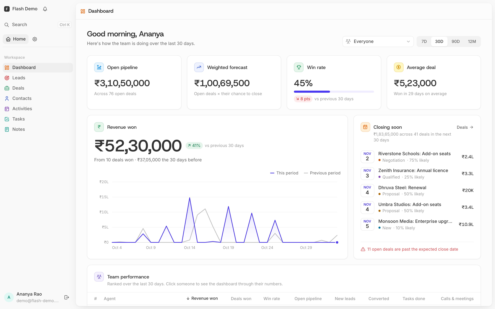
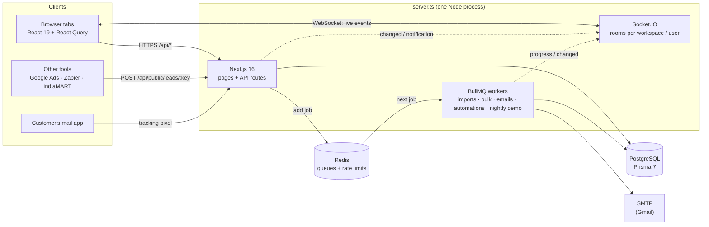
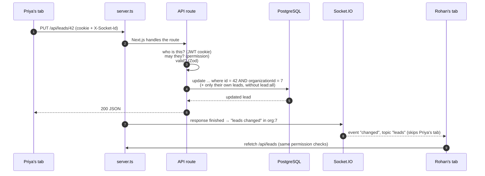
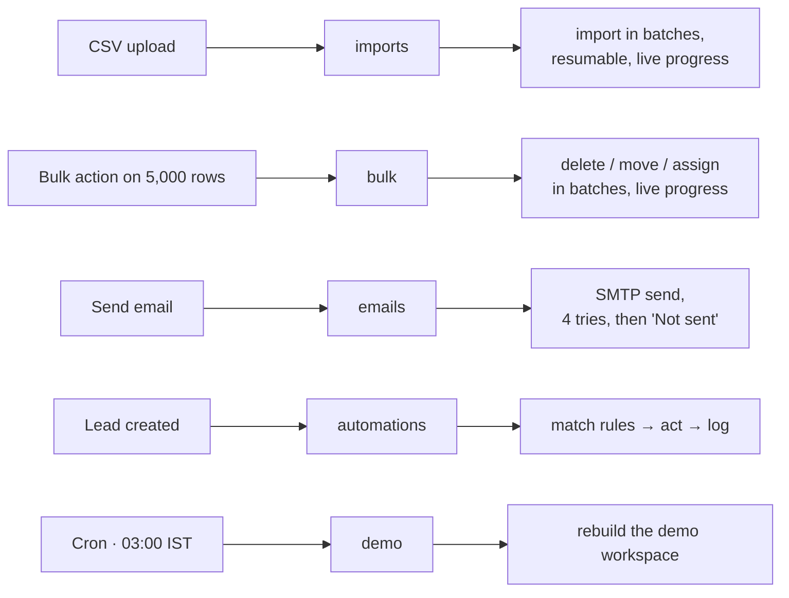
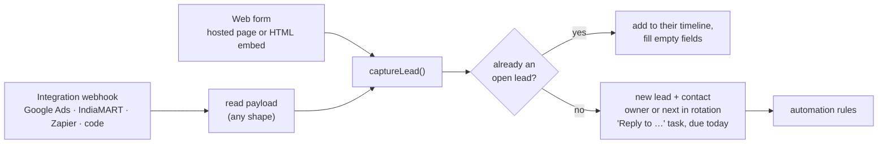
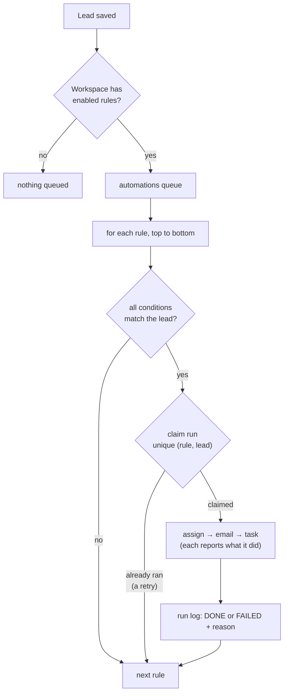
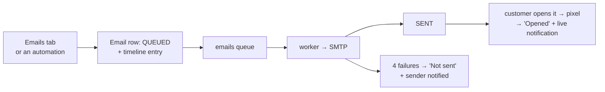
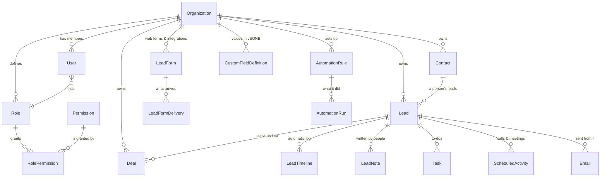

<div align="center">


# Flash

**A real-time, multi-tenant sales CRM for small sales teams.**
Capture leads from anywhere, work them through a pipeline, and let automations do the routine work.

<!-- After deploying, add the live link here: **[Live demo](https://…)** · -->


<br />



</div>

---

## Contents

1. [What is Flash?](#what-is-flash)
2. [Features](#features)
3. [Tech stack](#tech-stack)
4. [Architecture](#architecture)
5. [How it works](#how-it-works)
   - [Workspaces, sign-in and permissions](#workspaces-sign-in-and-permissions)
   - [Real-time updates and notifications](#real-time-updates-and-notifications)
   - [Background jobs](#background-jobs)
   - [Capturing leads: web forms, integrations, campaigns](#capturing-leads-web-forms-integrations-campaigns)
   - [Duplicates and merging](#duplicates-and-merging)
   - [Automation rules](#automation-rules)
   - [Email](#email)
   - [Lists, filters and boards](#lists-filters-and-boards)
   - [Dashboard](#dashboard)
   - [Demo mode](#demo-mode)
6. [Data model](#data-model)
7. [API](#api)
8. [Engineering decisions](#engineering-decisions)
9. [Reliability and security](#reliability-and-security)
10. [Project structure](#project-structure)
11. [Getting started](#getting-started)
12. [Testing](#testing)
13. [Deploying](#deploying)
14. [Roadmap](#roadmap)

---

## What is Flash?

Flash is a sales CRM built the way a real product is built: one workspace per company, roles and
permissions, live updates across every open tab, background jobs for anything slow, and integrations
that bring leads in by themselves.

A lead can arrive from a **web form**, a **Google Ads lead form**, **IndiaMART**, **Zapier / Make / Pabbly**,
a **CSV import**, or be typed in by hand. Every path follows the same rules: a duplicate check, an
owner (or the next person in a round-robin), and a "reply today" task. Then the workspace's
**automation rules** run: assign it, email it from a template, add a follow-up task. Managers watch
it all on a live dashboard: pipeline, forecast, win rate, which source and which **ad campaign**
brought revenue, and why deals were lost.

> **Try it in one click.** The login page has **Explore as a manager** and **Explore as a sales agent**.
> Both open a full demo workspace with 18 months of data, rebuilt every night.

---

## Features

<table>
<tr>
<td width="50%" valign="top">

### Leads, deals and contacts
- Leads move through stages, **convert into deals**, and end won or lost
- **List or kanban board** for leads, deals, tasks and activities; drag a card to change its stage
- Every lead has a **contact** (the person), shared by all their leads
- **Custom fields** of any type (text, number, date, yes/no, dropdown, team member), filterable and shown in lists
- A **timeline** of everything that happened, plus **notes with @mentions**
- **Lost reasons** asked at the moment something is lost

</td>
<td width="50%" valign="top">

### Lead capture
- **Web forms:** a form builder, a hosted page to share anywhere, and HTML to embed, with spam trap and rate limits
- **Lead integrations:** a private webhook per tool. Reads plain JSON, **Google Ads** and **IndiaMART** formats, with a log of every delivery
- **UTM campaign tracking**, through to revenue per campaign
- **CSV import** with column mapping, a sample file, problem rows, and progress; **CSV export** of any filtered list
- **Round-robin** assignment that's safe when leads arrive at the same moment

</td>
</tr>
<tr>
<td valign="top">

### Automation and email
- **When → If → Then rules** on new leads: assign (taking turns), send a template, create a task
- **Email** from any lead, deal or contact, sent through a queue
- **Templates** with placeholders (`{{lead.firstName}}`, `{{me.name}}`)
- **Open tracking:** "Rahul opened your email" arrives live
- A run log for every rule; retries never send a second email

</td>
<td valign="top">

### Real time and teamwork
- Every list, board, panel and dashboard **updates live** when a teammate changes something
- A **notification bell:** assigned to you, @mentioned, email opened, import finished
- **Tasks**, and **calls and meetings** with attendees and reschedule
- A **reminder 10 minutes before** a meeting, and a **popup with a chime at the start time**, on any page
- **⌘K search** across leads, deals, contacts, tasks and activities

</td>
</tr>
<tr>
<td valign="top">

### Insight
- Revenue won, with its trend against the previous period
- Open pipeline, **weighted forecast**, win rate, average deal, days to close
- **Source and campaign performance:** leads → conversion → revenue
- Lost reasons, deals closing soon, and a **team leaderboard** a manager can drill into

</td>
<td valign="top">

### Platform
- **Multi-tenant:** every record belongs to a workspace, every query is scoped to it
- **Roles and permissions** an admin builds: own records or everyone's, and access to each setting
- **Bulk actions** on up to 50,000 records as background jobs with a progress bar
- **Demo mode:** one-click logins and a nightly reset
- Works on phones: slide-in sidebar, responsive tables and panels

</td>
</tr>
</table>

---

## Tech stack

| Layer | Choice | Why |
|---|---|---|
| **Framework** | Next.js 16 (App Router), React 19, TypeScript | One codebase for pages and API. Server components check permissions before a page renders |
| **Server** | A custom Node server (`server.ts`) running Next.js, **Socket.IO 4** and the job workers | Next.js route handlers can't keep WebSockets open; one process lets any route push a live event |
| **Database** | **PostgreSQL** with **Prisma 7** (pg driver adapter) | Relational data with JSONB for custom fields, `pg_trgm` indexes for fast search, and triggers where they keep data correct |
| **Jobs and limits** | **Redis** with **BullMQ 5** and ioredis | Background work with retries and live progress; rate limits shared across servers and restarts |
| **Validation** | **Zod 4** | One schema per action, shared by the form and the API route |
| **Data fetching** | **TanStack React Query 5** and axios | Caching, paging, and one-line refetches when a live update arrives |
| **Forms** | react-hook-form | Fast forms with the same Zod rules as the server |
| **UI** | **Tailwind CSS 4**, Tabler icons, sonner toasts, **GSAP**, three.js | A light design system with tokens in one CSS file; smooth, transform-only motion |
| **Email** | **Nodemailer** over SMTP | Works with any provider; free with a Gmail account |
| **Files** | Papaparse | CSV import and export, with spreadsheet-formula escaping |
| **Auth** | JWT in an httpOnly cookie, bcrypt | No third party; the same cookie signs in the WebSocket |
| **Tests and CI** | **Vitest** against a real PostgreSQL, **GitHub Actions** | Tests the real routes, queries and constraints, on every pull request |

---

## Architecture

Flash is one **Next.js 16** app run by a small **custom Node server** (`server.ts`). That single
process serves the pages and the API, holds the **Socket.IO** connections, and runs the **BullMQ
workers**. **PostgreSQL** holds the data; **Redis** holds the job queues and rate limits.



### A request, start to finish

Every API route follows the same steps, and **nothing reaches the database without the workspace
scope**. After a successful write, the server tells everyone else in the workspace what changed
(only the topic, never the data), and their open pages refetch through the same permission checks.



Pages follow one pattern: a **server component** (`page.tsx`) loads who's signed in and what they may
do, then renders a **client view** with `can={{ update, delete, ... }}` flags. The browser only uses
those flags to hide buttons; the API checks every request again.

---

## How it works

### Workspaces, sign-in and permissions

- **Workspaces.** Registering creates a workspace (an `Organization`) with an Admin role, default
  lead stages, sources and a sales pipeline. Every business row carries `organizationId`.
- **Scoped queries.** Routes never write `where: { organizationId }` by hand. They start from a scope
  helper: `leadScope(user)` means "this workspace, and only this person's leads unless they have
  `lead:all`". A record outside it simply doesn't match, so the API answers 404 and never confirms
  that the id exists.
- **Sign-in.** Passwords are hashed with bcrypt. The session is a JWT in an **httpOnly cookie**,
  which the browser can't read from JavaScript; `src/proxy.ts` sends signed-out visitors to `/login`.
  Sign-in is limited to 10 attempts per 15 minutes for each address and email.
- **Roles.** An admin builds roles from permissions in Settings → Roles:

| Permission | Lets someone |
|---|---|
| `lead:create` · `read` · `update` · `delete` (same for `deal:` and `contact:`) | work on **their own** records |
| `lead:all` · `deal:all` · `contact:all` | see and work on **everyone's** records, assign to others, see the team on the dashboard |
| `task:all` · `activity:all` | see everyone's tasks, calls and meetings |
| `user:create` · `read` · `update` · `delete` (same for `role:`) | see and manage members and roles |
| `pipeline:manage` · `lead-stages:manage` · `lead-sources:manage` | edit stages and sources |
| `custom-fields:manage` · `lead-forms:manage` | edit custom fields, web forms and integrations |
| `email-templates:manage` · `automations:manage` | edit email templates and automation rules |

### Real-time updates and notifications

One Socket.IO connection per tab, on the same port as the app. It signs in with the same login
cookie, then joins two **rooms**: `org:<id>` (everyone in the workspace) and `user:<id>` (just them).

| Event | Sent to | What the tab does |
|---|---|---|
| `changed { topic }` | the workspace, except the tab that made the change | refetches only what that topic touches ("leads" refreshes lead lists, boards, panels, the dashboard) |
| `notification` | one person | adds it to the bell and shows a toast |
| `import-progress` / `bulk-progress` | the person who started it | moves the progress bar |

- **No route has live-update code.** `server.ts` watches every response: a successful write to
  `/api/leads/...` is announced as "leads changed". Background work (a web form lead, a finished
  import) announces itself.
- **Notifications are saved first, then pushed**, so the bell is still right after a reload, and
  someone who was offline sees them later.
- **Meeting reminders.** A loop checks every 30 seconds for calls and meetings starting in the next
  10 minutes and notifies everyone on them. It claims each reminder atomically (`reminderSentAt`), so
  nobody is reminded twice. Then, **at the start time**, the browser opens a popup on whatever page
  you're on (it checks the clock every second): mark as done, reschedule, or open it.

### Background jobs

Anything slow or worth retrying goes on a queue, so no request waits for it. Only ids travel in a
job; the real state lives in Postgres, so a job can resume after a crash or a deploy.



- **Retries:** a failed job is tried again after 10 s, 20 s, then 40 s. After the last try, whoever
  started it is told why.
- **CSV import:** up to 5 MB or 50,000 rows. Columns are matched automatically ("Mobile No." → Phone,
  "Assigned to: Priya" → that teammate). Each batch saves its rows *and* the progress counters in one
  transaction, so a retry carries on exactly where it stopped and never adds anyone twice. Rows it
  couldn't import are kept, with the reason, for download.
- **Bulk actions:** up to 200 records change instantly; above that, the matching ids are saved and a
  job works through them, with a progress card in the corner.
- **CSV export** is streamed rather than queued: it pages through the table by id and writes as it
  goes, so memory stays flat and the download starts at once.

### Capturing leads: web forms, integrations, campaigns

Web forms and integrations share one code path, `captureLead()`:



**Web forms.** A form builder in Settings sets the title, button, thank-you message or redirect, which
fields are required, and which custom fields to ask. Each form gets:
- a **hosted page** (`/f/<key>`) for an Instagram bio, WhatsApp or a QR code
- **HTML to embed** on any website
- a **JSON endpoint** for developers

Spam is stopped by a hidden honeypot field and a per-visitor rate limit.

**Integrations.** Each tool gets a private webhook link (`/api/public/leads/<key>`); the long random
key in it is the secret, and it can be rotated at any time. The payload reader understands:

```jsonc
// Plain JSON (Zapier, Make, Pabbly, your code): field names like full_name or "Mobile No." work too
{ "name": "Rahul Mehta", "phone": "+91 98765 43210", "email": "rahul@acme.com", "Budget": "5-10L" }

// Google Ads lead forms
{ "campaign_id": 123456, "user_column_data": [{ "column_id": "FULL_NAME", "string_value": "Meera Iyer" }] }

// IndiaMART
{ "RESPONSE": { "SENDER_NAME": "Kabir Shah", "SENDER_MOBILE": "+91-9812345678", "QUERY_MESSAGE": "Need 500 units" } }
```

Only name and phone are required. Any of the workspace's custom fields can be filled by name, and
anything else is kept on the lead's timeline, so nothing sent is lost. Every delivery is logged
(new lead, existing lead, or rejected with the reason and the raw data), and a **Send a test lead**
button proves the link works. A new integration is tagged with a lead source of its own name.

**Campaigns.** `?utm_source=google&utm_medium=cpc&utm_campaign=diwali-sale` on a form's link is saved
on the lead. The hosted page reads its own URL, the HTML embed fills hidden fields with a tiny
script, and Google Ads leads get their campaign id. The first campaign keeps the credit, and the
dashboard shows revenue per campaign.

### Duplicates and merging

- **One open lead per person.** A lead is the same person when its phone (last 10 digits) or email
  (lower case) matches. Those match keys are kept by a **database trigger**, so every write path stays
  correct and the lookup is an indexed query. "+91 98765-43210" and "9876543210" match.
- A second open lead is refused, with a link to the existing one. Someone who comes back after
  being lost or converted is a new opportunity and is allowed.
- Old and imported copies can be **merged**: pick which values win, and the duplicate's timeline,
  notes, tasks, activities and deals move over. Deals can be merged the same way.

### Automation rules

Rules are set up in Settings → Automations:

```
WHEN  a new lead is added (by hand, a web form or an integration)
IF    Source is Google Ads  AND  Campaign contains "diwali"          ← all must match; none = every lead
THEN  assign to Priya / Rohan (taking turns)
      send the "First reply" email
      add a task "Call {{lead.firstName}}", due today, high priority  ← in this order
```

Conditions can look at the source, the form or integration it came through, the campaign, the owner,
or any custom field, with *is*, *is not*, *contains*, *is empty* and *is filled in*.



What makes it safe:
- **No double emails on retries.** A unique `(ruleId, eventKey)` row is claimed before acting, so a
  job that fails halfway and runs again skips the rules it already ran.
- **No loops.** Actions never trigger rules.
- **Imports don't run rules**, so a 5,000-row import can't send 5,000 emails by surprise.
- **Failures are visible.** A broken step (a deleted template, someone who left) stops the rule with
  a clear reason, and the steps before it stay done.
- **Saving a lead never depends on a rule.** If Redis is down, the lead still saves.
- When a rule reassigns a web form lead, its "Reply to …" task moves to the new owner.

### Email



- **Sending.** Every email leaves from one SMTP address as "Priya via Acme", with **Reply-To set to
  the sender**, so the customer's reply lands in their own inbox. A free Gmail account with an app
  password is enough; Resend or Brevo work by changing environment variables.
- **Templates** fill in `{{lead.firstName}}`, `{{lead.company}}`, `{{deal.title}}`, `{{me.name}}` and
  `{{workspace.name}}` in the browser, so the sender sees and can edit the exact text.
- **Open tracking.** Each email ends with a 1×1 image at a random token's address. The first load
  marks it **Opened** and notifies the sender live. (It says "Opened", not "Read": some mail apps load
  images by themselves.)
- **Guard rails.** Typed text is escaped, never sent as HTML. Each person can send 100 emails a day,
  and the demo workspace never sends real email.

### Lists, filters and boards

- **Lists** page through the server (25, 50 or 100 per page). Columns can be shown, hidden, reordered
  and resized. A pencil on a cell edits it in place.
- **Filters** cover stage, source, owner, created or modified by and when, possible duplicates and any
  custom field. They can be saved as views.
- **Boards** load 25 cards per column, with "Load more", and stay fast with thousands of records.
- **The URL holds the page state:** view, filters, page and the open record. A refresh, the Back
  button and a shared link all bring back the same screen, and each page remembers your last view.
- **Search (⌘K)** uses trigram indexes, so "contains" matching across names, emails and titles stays fast.

### Dashboard

One request (`GET /api/dashboard?range=30d&agentId=`) runs Postgres `groupBy` and `aggregate`
queries in parallel. Only won deals' dates and amounts come back as rows, for the charts.
- Revenue won with its trend, compared with the previous period
- Open pipeline by stage, **weighted forecast** (each open deal × its probability), win rate, average deal, days to close
- Deals closing in the next 30 days, and those already past their date
- **Source and campaign performance:** new leads, conversion rate, deals won and revenue for each
- Lost reasons for leads and deals
- A **team table** ranking every agent; a manager can click one to see the dashboard through their numbers
- Periods of 7 days, 30 days, 90 days or 12 months; agents only ever see their own numbers

### Demo mode

`/api/auth/demo?as=manager` (or `?as=agent`) signs a visitor straight into a demo workspace: 6 people,
about 420 leads and 300 deals over 18 months, plus tasks, meetings, notes, emails, templates and a
sample automation. A **BullMQ job scheduler** rebuilds it every night at 03:00 IST. Demo accounts
can't change passwords or delete the workspace, and never send real email, so it stays the same for
every visitor.

---

## Data model

31 models. The core:



- **Custom fields** are defined per workspace and stored in a `customFields` JSONB column on each
  record. A single edit merges into it with `jsonb ||`, so two people editing different fields never
  overwrite each other.
- **Timeline vs notes:** `*Timeline` is an automatic, read-only history (created, stage changed,
  assigned, emailed, merged). `*Note` is written by people and supports @mentions.
- **Who did what:** leads, deals and contacts record `createdById` and `updatedById`.
- **Jobs are rows too:** `ImportJob` and `BulkJob` hold the progress, so a restart loses nothing.

---

## API

76 route handlers under `src/app/api`, one folder per resource. All of them are JSON, and all
of them check sign-in, permission, input (Zod) and workspace scope.

| Area | Routes |
|---|---|
| **Records** | `leads`, `deals`, `contacts`: list (filters, paging, `?format=csv`), create, read, update, delete, `assign`, `bulkUpdate`, `notes`, `timeline`; leads also `convert`, `merge`, `duplicates`; deals `merge`, `duplicates` |
| **Work** | `tasks`, `activities` (calls and meetings), `notes` (the notes feed) |
| **Email** | `emails` (list and send), `email-templates` |
| **Automation** | `automations` (rules, on/off), `automations/:id/runs` (the run log) |
| **Capture** | `lead-forms` (web forms and integrations), `lead-forms/:id/deliveries`, `imports` (+ `problems`, `sample`), `bulk-jobs` |
| **Workspace** | `agents` (members), `roles`, `permissions`, `lead-stages`, `lead-sources`, `pipeline-stages` (+ `reorder`), `custom-fields`, `saved-filters` |
| **You** | `auth/login`, `auth/register`, `auth/logout`, `auth/demo`, `me`, `me/password`, `notifications` |
| **Insight** | `dashboard`, `search` |
| **Public (no login)** | `public/forms/:key` (web forms), `public/leads/:key` (integration webhooks), `public/emails/:token/open` (open tracking), `health` |

---

## Engineering decisions

| Decision | Why |
|---|---|
| **One custom server** running Next.js, Socket.IO and the workers | Route handlers can't hold WebSockets. One process lets any route push a live event, and it's one thing to deploy. The workers can move to their own process later with no code change, because Redis sits between them |
| Live events carry **only the topic**, never data | Permissions stay in one place, the API. Nothing can leak over the socket, and no route needs live-update code |
| **Queues for slow work**, state in Postgres, only ids in jobs | Nothing blocks a request; jobs retry by themselves and resume after a restart from their last saved batch |
| **Duplicate matching in a database trigger** | Every write path (API, forms, imports, scripts) stays correct without remembering to, and the lookup is indexed |
| **Claim before acting** in automations | BullMQ retries failed jobs; without a unique claim, a retry would send a second email |
| **Rate limits in Redis that fail open** | Shared across servers and restarts. If Redis is down for a minute, forms keep working instead of the limiter taking the site down |
| **One webhook that reads many payload shapes** | Plain JSON, Google Ads and IndiaMART all become one shape, with field names guessed like the CSV importer does. One feature covers dozens of tools |
| **Integrations are web forms of another kind** (`LeadForm.kind = WEBHOOK`) | They get the source, owner, rotation and capture rules for free; only a payload reader and a log are new |
| **Email over plain SMTP** from one address, Reply-To the sender | Free with no domain, lands in inboxes, and moving providers is only configuration |
| **Template placeholders filled in the browser** | The sender sees and can edit the exact text before it goes |
| **Page state in the URL** | Refresh, Back and shared links all work |
| Rule conditions and form settings as **JSON checked by Zod** | A new action type or form option needs no migration, and old data reads back with defaults |
| **Integration tests against a real Postgres**, not mocks | They test the real routes, queries, triggers and constraints, the parts most likely to break |

---

## Reliability and security

- **Concurrency:** round-robin turns are counted in the database (`increment`), so two leads arriving together never get the same person. Reminders and automation runs are claimed atomically.
- **Retries:** jobs retry with backoff and report their final failure; nothing is done twice.
- **Big data:** checked with 10,000+ leads. Indexes for every list, board and filter; bulk actions in batches; CSV export streamed.
- **Abuse:** honeypot fields; rate limits on sign-in, forms (per visitor), webhooks (per link), imports and email (per person per day); webhook keys that can be rotated.
- **Injection:** every input checked by Zod; typed email text escaped; CSV export escapes spreadsheet formulas; Prisma parameterises every query.
- **Privacy between workspaces:** every query is scoped; other workspaces' ids answer 404. Open tracking uses random tokens, never ids.
- **Visibility:** every integration delivery and every automation run is logged with what happened and why.

---

## Project structure

```
crm/
├── server.ts                 Next.js + Socket.IO + job workers, on one port
├── prisma/
│   ├── schema.prisma         every model, commented
│   ├── migrations/           43 migrations, applied in order
│   ├── seed.ts               permissions and default stages
│   └── demo.ts               builds the demo workspace (npm run db:demo)
├── src/
│   ├── proxy.ts              signed-out visitors → /login
│   ├── app/
│   │   ├── (marketing)/      landing page, pricing, "Book a demo"
│   │   ├── (auth)/           login, register
│   │   ├── (dashboard)/      the app: dashboard, leads, deals, contacts, tasks, activities, notes,
│   │   │                     settings (members, roles, stages, custom fields, web forms,
│   │   │                     integrations, email templates, automations)
│   │   ├── f/[key]/          a web form's public page
│   │   └── api/              route handlers, one folder per resource; api/public needs no login
│   ├── components/           DataTable, Board, FilterPanel, Dropdown, Select, Modal, SidePanel, Toast…
│   └── lib/                  logic without React, grouped by purpose:
│       ├── auth/             current user, JWT, passwords, permissions and scopes
│       ├── db/               Prisma (Postgres) and Redis connections
│       ├── api/              API client, error handling, rate limits, CSV export
│       ├── realtime/         Socket.IO server, notify(), broadcastChange()
│       ├── jobs/             queues, the worker, CSV import, bulk actions
│       ├── leads/            capture, duplicates, webhook payloads, stages, sources
│       ├── emails/           sending, templates
│       ├── automations/      the rule engine
│       ├── demo/             the demo workspace
│       └── validations/      one Zod file per resource
└── tests/integration/        28 files, 146 tests, against a real Postgres
```

**Conventions:**
- Route files export only HTTP handlers; logic lives in `src/lib`.
- One Zod schema per action, shared by the form and the route.
- Comments explain *why*, in plain words.

---

## Getting started

**You need:** Node 20+, PostgreSQL and Redis.

```bash
git clone https://github.com/kavya-thakur/crm.git
cd crm
npm install

cp .env.example .env                                   # fill in DATABASE_URL, JWT_SECRET, REDIS_URL

npx prisma migrate deploy --config prisma7.config.ts   # build the database
npx prisma generate --config prisma7.config.ts         # build the Prisma client
npx tsx prisma/seed.ts                                 # permissions and default stages
npm run db:demo                                        # optional: the demo workspace

npm run dev                                            # http://localhost:3000
```

Open the login page and click **Explore as a manager**, or sign in as `demo@flash-demo.dev` / `demo1234`.

> Use `npm run dev`, not `next dev`: only `server.ts` has Socket.IO and the workers.
> On macOS, Redis is `brew install redis && brew services start redis`.

### Environment variables

| Variable | Needed | What it's for |
|---|---|---|
| `DATABASE_URL` | yes | PostgreSQL connection string |
| `JWT_SECRET` | yes | signs the login cookie; a long random string (`openssl rand -base64 32`) |
| `REDIS_URL` | yes | job queues and rate limits |
| `APP_URL` | in production | the site's public address, for link previews and email open tracking |
| `SMTP_HOST` `SMTP_PORT` `SMTP_USER` `SMTP_PASS` | for email | any SMTP server. With Gmail: a dedicated account, 2-Step Verification on, and an app password from myaccount.google.com/apppasswords |
| `SMTP_FROM` | optional | send from an address other than `SMTP_USER` |
| `DEMO_FORM_KEY` | optional | the marketing site's "Book a demo" form sends its leads into this web form |
| `TEST_DATABASE_URL` | optional | the database `npm test` uses (default: local `crm_test`) |

Without the SMTP settings nothing breaks: emails are saved and marked "Not sent", with the reason.

### Scripts

| Command | Does |
|---|---|
| `npm run dev` | the app with live updates and workers |
| `npm run build` · `npm start` | production build · production server |
| `npm test` | all integration tests |
| `npm run lint` | ESLint |
| `npm run db:demo` | build or rebuild the demo workspace (`DEMO_SCALE=25` for about 10,000 leads) |

---

## Testing

**146 integration tests in 28 files**, run with Vitest against a real PostgreSQL database. They call
the real route handlers, so permissions, workspace isolation, database triggers and constraints are
all tested, not mocked. Some of what they prove:

- an agent can't see, email or edit another agent's leads, and nobody can reach another workspace
- a second open lead for the same person is refused, and merging moves the duplicate's whole history over
- a retried automation job never sends a second email, and a failing step says why
- Google Ads and IndiaMART payloads become the right lead; bad ones are rejected and logged
- a retried CSV import carries on from where it stopped and adds nobody twice
- the open-tracking pixel marks an email opened once, and a made-up token changes nothing

```bash
createdb crm_test
DATABASE_URL="postgresql://localhost:5432/crm_test" npx prisma migrate deploy --config prisma7.config.ts
npm test
```

**GitHub Actions** runs the type check and the whole suite on every pull request, against a throwaway Postgres.

---

## Deploying

Flash needs a host that keeps a Node process running, because the WebSockets and the workers
live in it. That rules out serverless-only hosting. This repo deploys **for free** with:

| Part | Service | Notes |
|---|---|---|
| App (Next.js + Socket.IO + workers) | **Render** free web service | sleeps after 15 idle minutes; a free uptime ping keeps it awake |
| PostgreSQL | **Neon** free plan | doesn't expire (Render's free database is deleted after 30 days) |
| Redis | **Render Key Value** free | inside Render, no per-command billing (BullMQ talks to Redis constantly) |
| Email | **Gmail** SMTP | a dedicated account with an app password |

`render.yaml` is a **Render Blueprint** that describes the app and its Redis, so Render sets them
both up from the repo:

1. **Neon:** create a project (region: Singapore, near the app). Copy its connection string, the
   direct one rather than the pooled one, ending in `?sslmode=require`.
2. **Render:** New → **Blueprint** → pick this repo. When asked, paste the Neon string as
   `DATABASE_URL`, and the Gmail address and app password as `SMTP_USER` / `SMTP_PASS`.
   `JWT_SECRET` is generated and `REDIS_URL` is wired to the Key Value instance automatically.
3. **First deploy:** the build installs, generates the Prisma client, **applies the migrations** and
   builds. Then set `APP_URL` to the site's address (`https://….onrender.com`) and redeploy.
4. **Fill the database once**, from your own machine, pointed at Neon:
   ```bash
   DATABASE_URL="<neon connection string>" npx tsx prisma/seed.ts
   DATABASE_URL="<neon connection string>" npm run db:demo
   ```
5. **Keep it awake:** a free UptimeRobot (or cron-job.org) monitor on `https://….onrender.com/api/health`
   every 5 minutes. It checks the database too, so the nightly demo reset runs and webhooks never
   wait for a sleeping server.

---

## Roadmap

- More automation triggers (stage changed, deal won or lost) and **"wait 2 days, then…"** steps for follow-up sequences
- **Speed-to-lead alerts:** nobody has contacted a new lead within X hours, so the manager hears about it
- A **booking link** where a visitor picks a free slot and gets a lead and a meeting
- **Facebook and Instagram Lead Ads**, built in
- Products and quotes on deals

---

<div align="center">

Built by **Kavya Thakur** · [GitHub](https://github.com/kavya-thakur)

</div>
